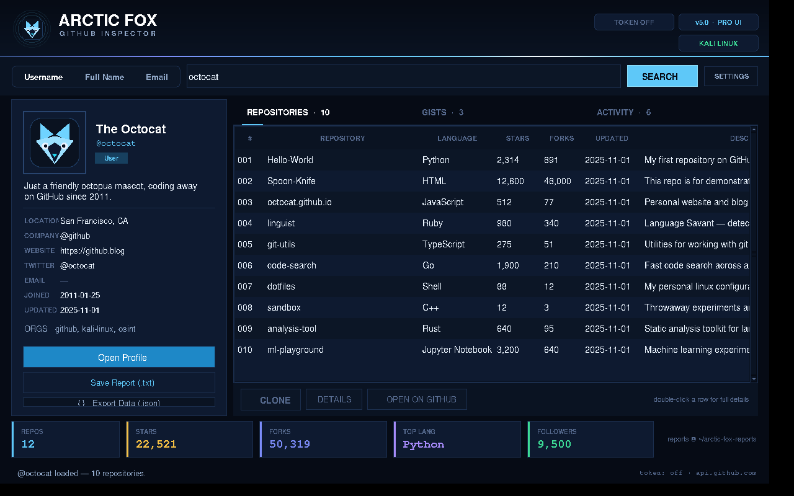
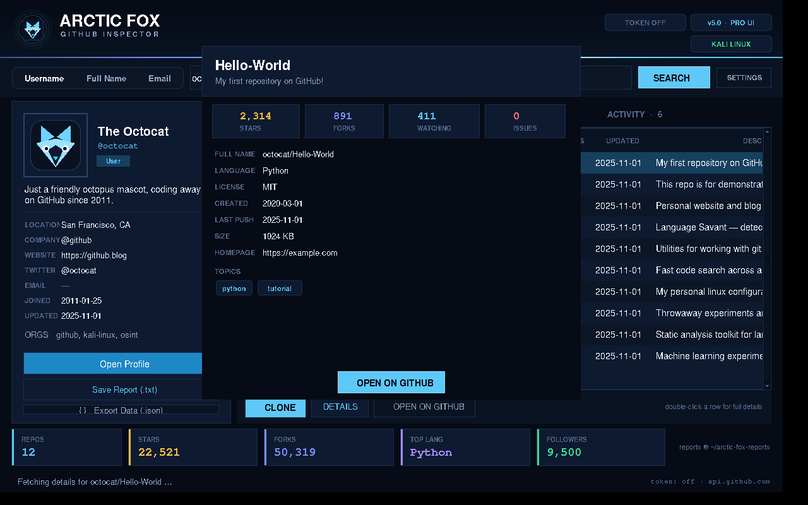
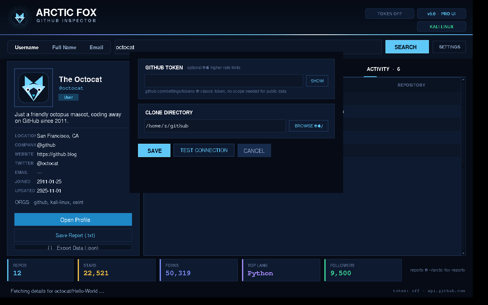

<div align="center">

# ❄️ ARCTIC FOX — GitHub Search v5.0

**GitHub Account & Repository Inspector — Desktop GUI Edition for Kali Linux**



<p>
  
  
  
  
</p>

**Search** · **Inspect** · **Clone** · **Report** — with one command install.

</div>

---

## What is Arctic Fox?

Arctic Fox is a desktop tool for exploring GitHub accounts and public repositories.
Type a username and get the full public profile, every repository with stars, forks,
languages and topics, public gists, recent activity, organizations — then clone a repo,
open it in the browser, or export a report.

**v5.0 "Frost Pro" is a complete visual upgrade:** a professional Arctic Night
interface with a real fox logo header, living aurora light strip, smooth 30 fps
animation everywhere and glass cards — still 100% Python standard library.

## What's new in v5.0 — Frost Pro UI

| | |
|---|---|
| 🦊 **Real logo header** | The ASCII-art banner is gone — the actual Arctic Fox logo with a soft halo, wordmark and a living aurora light strip that flows across the header |
| 🎬 **Smooth animation everywhere** | 30 fps tween engine: buttons fade on hover, the search field glows on focus, the tab underline slides, dialogs and toasts ease in — nothing snaps |
| 🌌 **Arctic Night theme** | Deeper, glassier dark palette with a refined accent system (ice · indigo · gold) and proper typography hierarchy |
| 🔘 **Segmented search modes** | Username / Full name / Email as an animated pill selector instead of a dropdown |
| 📊 **Count-up stat tiles** | Stats animate from 0 to value with easing when a profile loads |
| 💀 **Skeleton loading** | The profile card pulses with skeleton placeholders while data is being fetched |
| 🔔 **Toast notifications** | Reports, clones and errors now arrive as glass toasts sliding up from the corner — no more blocking popups |
| 🖱️ **Hover-highlight tables** | Rows light up under the mouse, taller rows, thin styled scrollbars |
| 🪟 **Centered modal dialogs** | Settings, repo details and user results are centered, modal, Escape-closable |
| ⌨️ **Shortcuts** | `Ctrl+F` / `Ctrl+K` focus search · `Ctrl+A` select text · `Ctrl+L` clear · `Enter` search · double-click a gist to open it |

## v5.0.1 stability fixes

- Main window is displayed immediately (removed the broken transparent startup tween).
- Window size is fitted and centred for the available desktop resolution.
- The animation loop starts only after the UI has been built and shown.
- The no-display launcher fallback now forwards CLI arguments correctly.

## v5.0.2 visual and avatar update

- Shows the supplied Moonlit Fox wallpaper for 3 seconds at launch, then opens the GUI.
- Refreshed the interface palette to a moonlit blue/violet theme.
- GitHub profile avatars now decode PNG, JPEG, and WebP when Pillow is installed; otherwise Tk's built-in PNG/GIF support is used.
- Requests GitHub avatar images with an image-friendly Accept header.

## Features

| Feature | Description |
|---|---|
| 🔍 Username lookup | Full public profile of any GitHub account |
| 👥 User search | Search by username, full name or email |
| 📦 Repository explorer | Sortable list of public repos with stars, forks, language, topics |
| 📊 Stats bar | Live totals for repos / stars / forks / top language / followers |
| ℹ️ Repo details | Full details dialog — license, size, issues, topics, homepage |
| ⤓ Clone | Shallow `git clone` with live progress in the status bar |
| ↗ Browser | Open profiles and repos on GitHub |
| 📄 Reports | Detailed `.txt` report and structured `.json` export |
| 📚 Gists & activity | Public gists and recent public events in their own tabs |
| 🏢 Organizations | Associated organizations shown on the profile card |
| ⚙️ Settings | GitHub API token + clone directory |
| 🎨 Arctic Night theme | Dark glassy UI with aurora accent lighting |

<div align="center">

| Repo details | Settings |
|---|---|
|  |  |

</div>

## Requirements

- **Kali Linux** (installer is Kali-specific; `--force` works on Debian/Ubuntu)
- Python 3 with Tkinter (`python3-tk`) — installed automatically
- Git — installed automatically
- Internet connection

## Installation (one command)

```bash
git clone https://github.com/arcticfox-cyber/Arctic-Fox-GitHub-Search-v5.0.git
cd Arctic-Fox-GitHub-Search-v5.0
sudo bash install.sh
```

The installer will:

1. Detect Kali Linux
2. Install `python3`, `python3-tk`, `git`, `xdg-utils` if missing
3. Copy the app to `/opt/arctic-fox`
4. Create the **`af`** command (`arcticfox` works too)
5. Add **Arctic Fox** to your Applications menu

### No installation — just run it

Extracted the ZIP but don't want to install anything yet?

```bash
bash run.sh
```

`run.sh` checks python3, tkinter and your display, offers to install what's
missing, and falls back to terminal mode automatically.

### One-liner (no clone)

```bash
curl -sSL https://raw.githubusercontent.com/arcticfox-cyber/Arctic-Fox-GitHub-Search-v5.0/main/remote-install.sh | sudo bash
```

> The one-liner only works **after the project is on GitHub**. Downloaded the ZIP
> manually? Use `sudo bash install.sh` instead — same result.

### Something not working?

Run the built-in doctor — it finds the problem and prints the exact fix:

```bash
bash doctor.sh
```

### Uninstall

```bash
sudo bash install.sh --uninstall
```

Config and saved reports are kept on uninstall.

## Usage

```bash
af                # start the GUI
af octocat        # open the GUI and search a username directly
af --cli          # classic terminal edition
af --cli octocat  # terminal edition, direct search
af --help
bash run.sh       # same as 'af' — but works from the extracted folder, no install
```

### In the GUI

1. **Search** — pick a mode (`Username`, `Full Name`, `Email`), type, hit **Enter** or **SEARCH**
2. **Profile card** — avatar, bio, location, company, links, orgs
3. **Repositories tab** — click a row, then `▼ CLONE`, `Details` or `Open on GitHub` (double-click = details)
4. **Gists / Activity tabs** — public gists and recent events
5. **Stats bar** — live totals update after every search
6. **Save Report (.txt)** / **Export Data (.json)** — written to `~/arctic-fox-reports/`
7. **SETTINGS** — GitHub token and clone directory

## GitHub API token (optional)

Without a token GitHub allows limited API requests (60/hour). Add a token and the
limit rises to 5,000/hour — search also becomes far more generous.

1. Generate a token at <https://github.com/settings/tokens> (classic, no scope needed for public data)
2. Open **SETTINGS** in Arctic Fox, paste the token, **SAVE**

The token is stored locally in `~/.config/arctic-fox/config.json` with `600` permissions.
Never share it with anyone.

## Reports

```
~/arctic-fox-reports/
├── octocat-20260101-120000.txt    # human-readable report
└── octocat-20260101-120000.json   # structured data export
```

## Project structure

```
Arctic-Fox-GitHub-Search-v5.0/
├── arcticfox_gui.py       # GUI edition (main app)
├── arcticfox-cli.py       # terminal edition (af --cli)
├── arcticfox_core.py      # shared GitHub API layer
├── install.sh             # one-command Kali installer
├── run.sh                 # quick launcher — no install needed
├── doctor.sh              # self-diagnosis (run this when errors appear)
├── remote-install.sh      # curl | bash one-liner
├── assets/arcticfox-icon.png
├── docs/                  # screenshots
└── README.md
```

## Troubleshooting

**Step 1 — always:** `bash doctor.sh` (from the project folder). It pinpoints
the problem and prints the fix. Common errors:

| Error message | Meaning & fix |
|---|---|
| `ModuleNotFoundError: No module named 'tkinter'` | GUI toolkit missing → `sudo apt install -y python3-tk` (or just run `bash run.sh`, it offers to install it) |
| `_tkinter.TclError: no display name and no $DISPLAY` | You are on SSH / headless / Termux — the GUI needs a desktop. Use terminal mode: `af --cli` |
| `SyntaxError` on start with `python` | You used Python 2 — always run with **python3** (or `bash run.sh`) |
| `curl: (22) The requested URL returned error: 404` from the one-liner | Project not uploaded under that repo name yet → extract the ZIP and run `sudo bash install.sh` locally |
| `apt-get update failed` | Check internet / VPN / proxy; retry `sudo apt update` then the installer again |
| `af: command not found` after install | Open a **new** terminal — `/usr/local/bin` must be in `$PATH` |
| Rate limit reached (403) | Add a token in **SETTINGS** (60 → 5,000 req/h) |
| "No such account found (404)" | Check the spelling — the account does not exist |
| Clone fails | Check internet; git must be installed: `sudo apt install -y git` |
| Termux / NetHunter-rootless | No desktop GUI possible there — use `python3 arcticfox-cli.py` |

## Responsible use

Arctic Fox only reads **public** GitHub data through the official GitHub REST API.
Use it for education, research and legitimate OSINT work. Respect GitHub's Terms of
Service, API rate limits and user privacy.

## Credits & license

Built by **[@arcticfox-cyber](https://github.com/arcticfox-cyber)** · v5.0 Frost Pro UI · MIT License — see [LICENSE](LICENSE).

If this tool is useful to you, leave a ⭐ on the repository. **Stay frosty.** ❄️🦊
