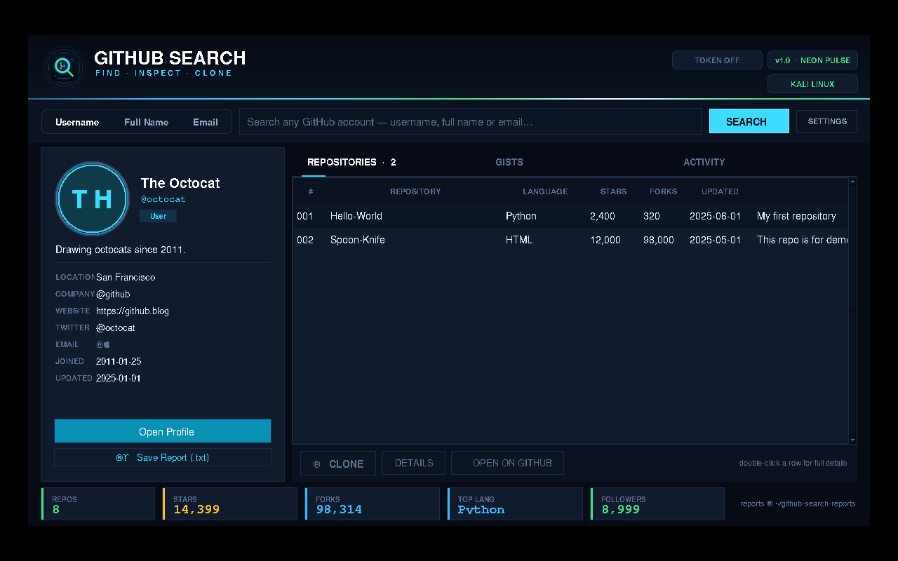
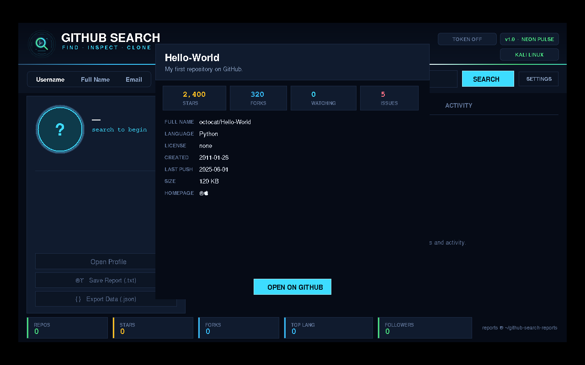
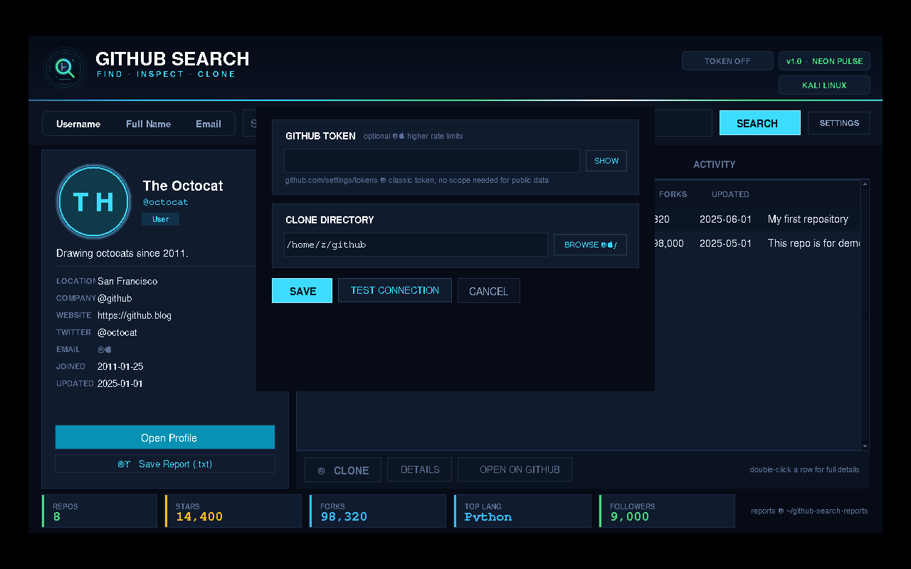

# 🌙 GITHUB SEARCH v1.0

**GitHub Account & Repository Inspector · Desktop GUI for Kali Linux**

  
  
  
  

**Search · Inspect · Clone · Export**

[Repository](https://github.com/arcticfox-cyber/GitHub-Search) · [Issues](https://github.com/arcticfox-cyber/GitHub-Search/issues)

---

## Overview

GitHub Search is a Python desktop application for searching GitHub users and exploring their publicly available profile and repository information. Search by username, full name, or email; inspect repositories, gists and recent public activity; clone repositories; and export reports.

The v1.0 interface uses the **GitHub Dark Pro** theme — carbon-dark surfaces straight from GitHub's own dark palette, emerald CTA buttons, azure links and violet spark highlights. Every animation runs on one consistent timing scale (120 / 220 / 320 ms) for a professional feel: animated header entrance (brand slides from the left, status pills from the right), smooth tab underline and search-mode knob, color-lerp button hovers. At startup, the app window opens at its normal size and the wallpaper boot screen plays **inside the window** for exactly **3 seconds** (cover-fit scaling, like modern app splash panels) with an animated progress bar. The wallpaper is painted before the window is ever mapped, so the very first frame on screen is the boot screen — no flicker — then it smoothly **melts into the app background** and the GUI appears with a soft brightness settle. The boot stays inside the app window, never fullscreen. Profile avatars render as perfect circles inside a glowing ring, and the app ships a new magnifier-style logo and icon.

## Features

| Feature | What it does |
|---|---|
| User search | Search by GitHub username, full name, or email |
| Profile inspector | View public profile details, avatar, followers, and organizations |
| Repository explorer | Browse repositories with stars, forks, language, topics, and update dates |
| Repository details | Inspect license, size, issues, topics, and homepage where supplied by GitHub |
| Clone | Shallow-clone a selected public repository |
| Browser | Open a GitHub profile, gist, or repository in the browser |
| Gists and activity | Browse public gists and recent public events |
| Reports | Save human-readable TXT reports and structured JSON exports |
| Settings | Configure an optional GitHub token and clone directory |
| GUI | GitHub Dark Pro theme (indigo night · violet moon glow · cyan sparks) |
| Startup splash | GitHub Dark Pro wallpaper boot screen for 3 seconds with progress bar |

Screenshots:

| Repository details | Settings |
|---|---|
|  |  |

## Requirements

- Kali Linux or a compatible Debian-based Linux distribution with a desktop session
- Python 3
- Tkinter for the graphical interface
- Git for repository cloning
- Internet connection
- Pillow is optional; it improves compatibility with JPEG/WebP avatars and image scaling

Install the system dependencies:

~~~bash
sudo apt update
sudo apt install -y python3 python3-tk git xdg-utils
~~~

Optional Pillow support:

~~~bash
python3 -m pip install --user Pillow
~~~

## Installation

### 1. Clone this repository

~~~bash
git clone https://github.com/arcticfox-cyber/GitHub-Search.git
~~~

### 2. Enter the application directory

~~~bash
cd GitHub-Search/GitHub-Search-v1
~~~

### 3. Install GitHub Search

~~~bash
sudo bash install.sh
~~~

The installer checks for Kali Linux, installs missing system dependencies, copies the application and its runtime image assets to **/opt/github-search**, creates the **af** and **github-search** commands, and adds an Applications menu entry.

For another Debian-based distribution, use the explicit override:

~~~bash
sudo bash install.sh --force
~~~

### Quick launch without installing

From the application directory:

~~~bash
bash run.sh
~~~

The launcher checks Python, Tkinter, and the display environment. The splash PNG must remain in the assets directory beside the application source.

### Remote one-line installer

~~~bash
curl -fsSL https://raw.githubusercontent.com/arcticfox-cyber/GitHub-Search/main/GitHub-Search-v1/remote-install.sh | sudo bash
~~~

Only run installation scripts from a source you trust. To review the script first, open the remote-install.sh file in this repository before executing it.

## Commands

After installation:

| Command | Action |
|---|---|
| **af** | Start the GUI |
| **af octocat** | Open the GUI and search for a username |
| **af --cli** | Start the terminal edition |
| **af --cli octocat** | Search a username in terminal mode |
| **af --help** | Show GUI usage information |
| **af --version** | Show the application version |
| **sudo bash install.sh --uninstall** | Remove the installed application |

Without installing, from the application directory:

~~~bash
bash run.sh
bash run.sh octocat
bash run.sh --cli
python3 arcticfox-cli.py
python3 arcticfox-cli.py octocat
python3 arcticfox_gui.py --help
python3 arcticfox_gui.py --version
~~~

The GUI requires a working Linux desktop display. The terminal edition can be used over SSH or on headless systems.

## Using the GUI

1. Choose **Username**, **Full Name**, or **Email** search mode.
2. Enter the search term and press Enter or click **SEARCH**.
3. Review the profile card, avatar, account details, and statistics.
4. Open the **Repositories**, **Gists**, or **Activity** tabs.
5. Select a repository to view details, clone it, or open it on GitHub.
6. Use **Save Report** for a TXT report or **Export Data** for JSON.
7. Open **Settings** to configure a token or clone directory.

## GitHub API token (optional)

GitHub Search can query public GitHub information without a token, subject to GitHub's unauthenticated rate limits. An optional personal access token can provide a higher API rate limit.

1. Create a token in [GitHub Settings](https://github.com/settings/tokens).
2. Open **Settings** in GitHub Search.
3. Paste the token and select **Save**.

The application stores its configuration at:

**~/.config/github-search/config.json**

The configuration file is written with owner-only permissions (0600). Never share your token or commit it to this repository.

## Reports and configuration

Reports are saved in:

**~/github-search-reports/**

The configuration file is saved in:

**~/.config/github-search/config.json**

The clone directory defaults to:

**~/github/**

## Project structure

~~~text
GitHub-Search-v1/
├── arcticfox_gui.py
├── arcticfox-cli.py
├── arcticfox_core.py
├── install.sh
├── run.sh
├── remote-install.sh
├── doctor.sh
├── README.md
├── assets/
│   ├── arcticfox-icon.png
│   ├── icon-v1.png
│   ├── logo-v1.png
│   ├── moonlit-fox-splash.png
│   └── moonlit-fox-splash.gif
└── docs/
    ├── screenshot-main.png
    ├── screenshot-details.png
    └── screenshot-settings.png
~~~

## Troubleshooting

### GUI does not open

~~~bash
sudo apt update
sudo apt install -y python3 python3-tk
bash doctor.sh
~~~

Run from the application directory to see startup errors:

~~~bash
python3 arcticfox_gui.py
~~~

### Splash image is missing

Confirm the following file exists:

**assets/moonlit-fox-splash.png**

If running the installed application, confirm the installer copied it to:

**/opt/github-search/assets/moonlit-fox-splash.png**

Reinstall from the project directory after updating:

~~~bash
sudo bash install.sh
~~~

### GitHub avatar does not display

Check your internet connection. For broader image-format support, install Pillow:

~~~bash
python3 -m pip install --user Pillow
~~~

### GitHub rate limit reached

Wait for the rate limit to reset or configure a personal access token in Settings. Do not paste tokens into issues, screenshots, or public messages.

### No display / SSH / headless system

The GUI needs a desktop session. Use terminal mode instead:

~~~bash
python3 arcticfox-cli.py
~~~

### Launcher command not found

Open a new terminal after installation and check that **/usr/local/bin** is in your PATH. You can also run the application directly with:

~~~bash
bash run.sh
~~~

## Security and responsible use

GitHub Search uses the official GitHub REST API to retrieve information made publicly available by GitHub. It does not bypass private repository permissions. Respect GitHub's Terms of Service, API limits, and user privacy. Keep access tokens private.

## Version history

### v1.0

- **Full redesign — "GitHub Dark Pro":** carbon-dark surfaces straight from GitHub's own dark palette with emerald CTA buttons, azure links and violet spark highlights; the old look is gone from every widget, button, dialog and chart color.
- **Consistent motion system:** every animation (hovers, tab underline, search-mode knob, boot reveal, toasts) runs on one timing scale — 120 ms / 220 ms / 320 ms — for a smooth professional feel.
- **Animated header entrance:** the brand slides in from the left and the status pills from the right each time the app appears.
- **In-app boot splash:** the window opens at its normal size and the wallpaper fills the window for exactly 3 seconds (cover-fit scaling, upscaled with Pillow when needed) with an animated progress bar. The boot is painted before the window maps (first frame = wallpaper, zero flicker) and then melts smoothly into the app background instead of hard-swapping. The boot screen lives inside the app window — no fullscreen takeover, and it follows window resizes while booting.
- **Circular profile avatar:** photos are clipped to a perfect circle with an anti-aliased mask and wrapped in a glowing accent ring; the fallback initials render on a circle too.
- **New logo & icon style:** a fresh magnifier-with-git-branch app icon (`icon-v1.png`) and header logo (`logo-v1.png`), plus a restyled header wordmark ("FIND · INSPECT · CLONE").
- **Renamed the tool to "GitHub Search"** across the GUI, CLI, installers and menu entries.
- Search started from the command line now runs after the splash finishes.
- Settings dialog height increased so all controls fit.

### v5.0.3

- Updated the moonlit splash startup flow and native image loading.
- Improved launcher handling for CLI mode and paths.
- Installer now copies the splash GIF and other runtime artwork into the installed assets directory.
- Corrected the remote installer to use this repository and its nested application directory.
- Updated the application version and repository URL.

### v5.0.2

- Added the GitHub Dark Pro splash artwork and blue-violet interface palette.
- Improved avatar image handling.

### v5.0.1

- Improved startup visibility and screen-size handling.
- Fixed the CLI fallback argument forwarding.

## License

**GitHub Search is proprietary software.** All rights are reserved by the copyright holder. Viewing the source and personal evaluation are permitted. Copying, modifying, redistributing, sublicensing, or creating derivative works requires prior written permission.

See the [Proprietary License](../LICENSE) in this directory. This project is **not** distributed under the MIT License.

## Support

Found a bug? Open an [issue](https://github.com/arcticfox-cyber/GitHub-Search/issues) and include your Linux distribution, Python version, launch command, and relevant error output. Remove tokens and other secrets before sharing logs.

---

**🌙 GITHUB SEARCH**

*Explore · Discover · Inspect*

Developed by [@arcticfox-cyber](https://github.com/arcticfox-cyber)

**Happy Searching.**

