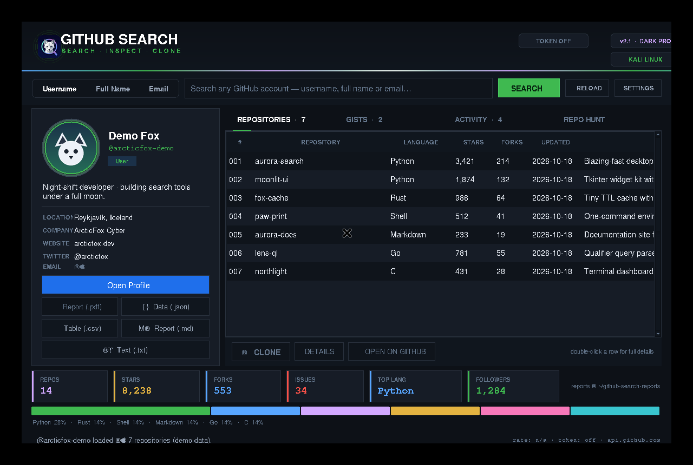
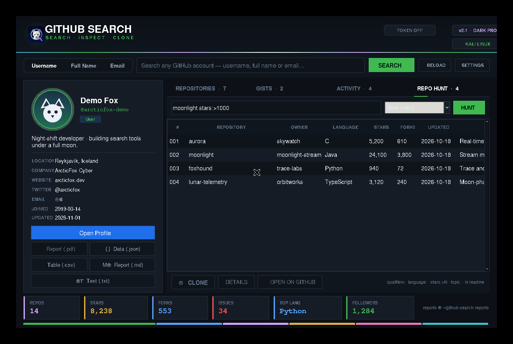
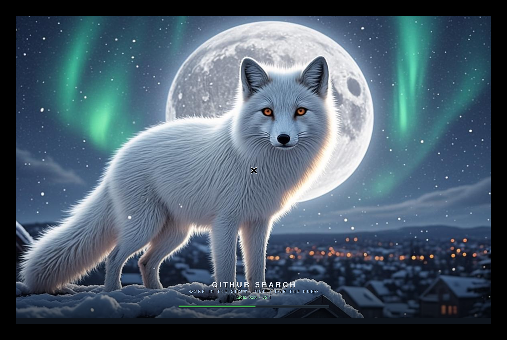
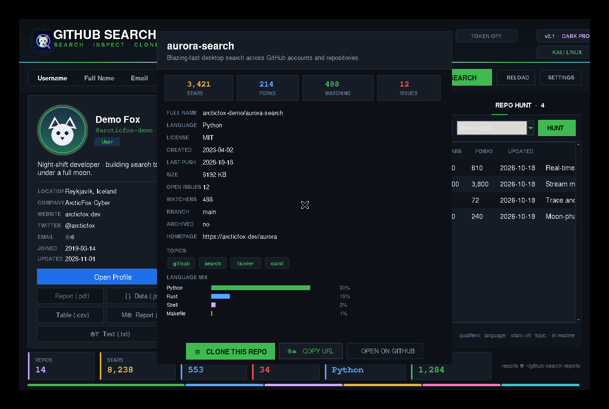
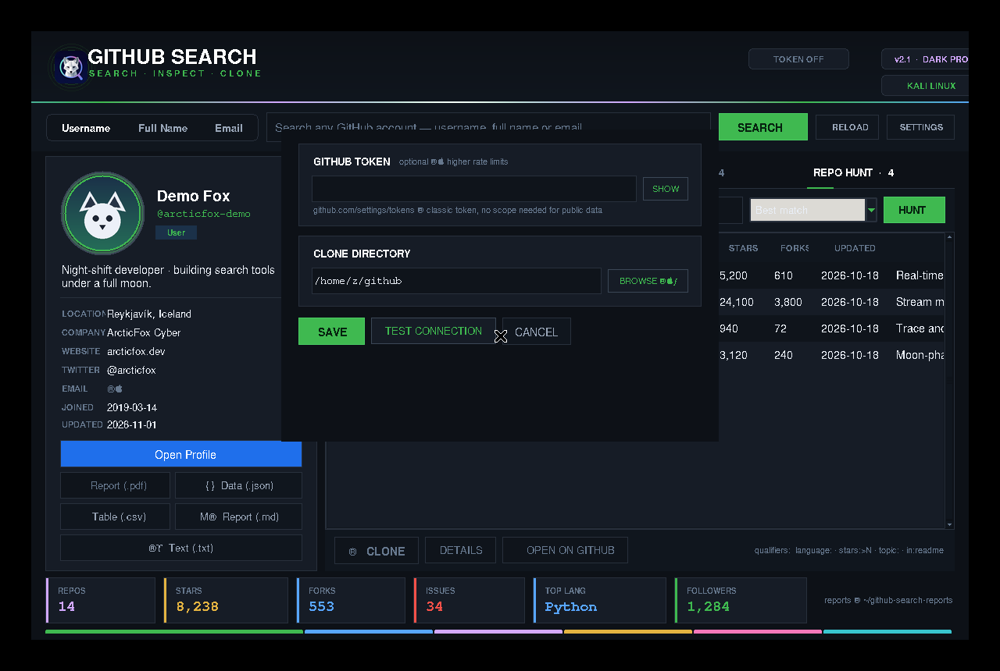

# GITHUB SEARCH v3.0

**GitHub Account & Repository Inspector · Desktop GUI for Kali Linux**

*❄ Born in the snow, built for the hunt.*

  
  
  
  

**Search · Inspect · Clone · Export**

[Repository](https://github.com/arcticfox-cyber/GitHub-Search) · [Issues](https://github.com/arcticfox-cyber/GitHub-Search/issues)

---

## Overview

GitHub Search is a Python desktop application for searching GitHub users and exploring their publicly available profile and repository information. Search by username, full name, or email; inspect repositories, gists and recent public activity; hunt repositories across all of GitHub; clone repositories; and export reports as a polished **PDF**, TXT, JSON, CSV or Markdown.

The v3.0 "frostfall" upgrade keeps the beloved **GitHub Dark Pro** theme — carbon-dark surfaces straight from GitHub's own dark palette, emerald CTA buttons, azure links and violet spark highlights — and makes the **PDF report download bullet-proof**: the Report (.pdf) button now activates correctly with the other export buttons (it previously stayed disabled), a native **Save-As dialog** opens first and defaults to your Downloads folder, the report builds on a **background thread** so the interface never freezes, and the finished report can be revealed in your file manager straight from the success prompt. The PDF engine itself is fully defensive — profiles with missing or odd fields (cached data, renamed accounts) can no longer crash it. Everything from v2.1 stays: one-click **PDF reports** powered by a tiny built-in PDF engine (zero external libraries, works on a fresh Kali box), the pure **white arctic fox boot wallpaper** with a full moon and aurora — born in the snow, built for the hunt — the Repo Hunt engine, sortable tables, search history, language analytics, five export formats, a live rate-limit budget, an API response cache with automatic retry, and the moonlit fox logo and icon. Every animation still runs on one consistent timing scale (120 / 220 / 320 ms). At startup, the app window opens at its normal size and the wallpaper boot screen plays **inside the window** for exactly **3 seconds** (cover-fit scaling, like modern app splash panels) with the tagline *"Born in the snow, built for the hunt."*, an animated progress bar, then smoothly **melts into the app background**. Profile avatars render as perfect circles inside a glowing ring.

## Features

| Feature | What it does |
|---|---|
| User search | Search by GitHub username, full name, or email |
| **Repo Hunt** *(new)* | Search every public repository on GitHub — supports qualifier queries like `tetris language:python stars:>500` |
| Profile inspector | View public profile details, avatar, followers, and organizations |
| Repository explorer | Browse repositories with stars, forks, language, topics, and update dates |
| **Sortable tables** *(new)* | Click any column heading in every table to re-sort instantly |
| **Search history** *(new)* | Press ↑ / ↓ in the search box to flip through your last 10 lookups |
| **Language analytics** *(new)* | Live language-mix bar under the stats chips + per-repo language breakdown |
| Repository details | Inspect license, size, issues, topics, homepage — and copy the URL or clone right from the dialog |
| Clone | Shallow-clone a selected public repository |
| Browser | Open a GitHub profile, gist, or repository in the browser |
| Gists and activity | Browse public gists and recent public events |
| Reports | Save human-readable TXT reports and structured JSON exports |
| **PDF reports** *(new in v2.1, fixed in v3.0)* | One click produces a polished A4 PDF — dark arctic header with the snowflake mark, stats chips, language-mix bar, repository table, gists and activity. Built-in engine, no external libraries. v3.0: Save-As dialog (defaults to Downloads), background-thread build so the UI never freezes, reveal-in-folder prompt |
| **CSV & Markdown exports** | One-click spreadsheet table and rich Markdown report |
| **Smart core** *(new)* | API response cache, automatic retry with backoff, live rate-limit budget in the status bar |
| **Refresh** *(new)* | Re-fetch the loaded profile with a cold cache (F5 / ↻) |
| Settings | Configure an optional GitHub token and clone directory |
| GUI | GitHub Dark Pro theme (indigo night · violet moon glow · cyan sparks) |
| Startup splash | White arctic fox wallpaper boot screen for 3 seconds with progress bar and the "Born in the snow, built for the hunt." tagline |

Screenshots:

| Repo Hunt (v2.0) | Boot splash — white arctic fox (v2.1) |
|---|---|
|  |  |

| Repository details | Settings |
|---|---|
|  |  |

## Requirements

- Kali Linux or a compatible Debian-based Linux distribution with a desktop session
- Python 3
- Tkinter for the graphical interface
- Git for repository cloning
- Internet connection
- Pillow is optional; it improves compatibility with JPEG/WebP avatars and image scaling

Install the system dependencies:

~~~bash
sudo apt update
sudo apt install -y python3 python3-tk git xdg-utils
~~~

Optional Pillow support:

~~~bash
python3 -m pip install --user Pillow
~~~

## Installation

### 1. Clone this repository

~~~bash
git clone https://github.com/arcticfox-cyber/GitHub-Search.git
~~~

### 2. Enter the application directory

~~~bash
cd GitHub-Search/GitHub-Search-v3
~~~

### 3. Install GitHub Search

~~~bash
sudo bash install.sh
~~~

The installer checks for Kali Linux, installs missing system dependencies, copies the application and its runtime image assets to **/opt/github-search**, creates the **af** and **github-search** commands, and adds an Applications menu entry.

For another Debian-based distribution, use the explicit override:

~~~bash
sudo bash install.sh --force
~~~

### Quick launch without installing

From the application directory:

~~~bash
bash run.sh
~~~

The launcher checks Python, Tkinter, and the display environment. The splash PNG must remain in the assets directory beside the application source.

### Remote one-line installer

~~~bash
curl -fsSL https://raw.githubusercontent.com/arcticfox-cyber/GitHub-Search/main/GitHub-Search-v3/remote-install.sh | sudo bash
~~~

Only run installation scripts from a source you trust. To review the script first, open the remote-install.sh file in this repository before executing it.

## Commands

After installation:

| Command | Action |
|---|---|
| **af** | Start the GUI |
| **af octocat** | Open the GUI and search for a username |
| **af --cli** | Start the terminal edition |
| **af --cli octocat** | Search a username in terminal mode |
| **af --cli --repos 'tetris language:python stars:>500'** | Repo Hunt in terminal mode |
| **af --help** | Show GUI usage information |
| **af --version** | Show the application version |
| **sudo bash install.sh --uninstall** | Remove the installed application |

Without installing, from the application directory:

~~~bash
bash run.sh
bash run.sh octocat
bash run.sh --cli
python3 arcticfox-cli.py
python3 arcticfox-cli.py octocat
python3 arcticfox_gui.py --help
python3 arcticfox_gui.py --version
~~~

The GUI requires a working Linux desktop display. The terminal edition can be used over SSH or on headless systems.

## Using the GUI

1. Choose **Username**, **Full Name**, or **Email** search mode.
2. Enter the search term and press Enter or click **SEARCH** (↑ / ↓ recalls recent searches).
3. Review the profile card, avatar, account details, statistics and the language-mix bar.
4. Open the **Repositories**, **Gists**, or **Activity** tabs — click a heading to sort.
5. Select a repository to view details, clone it, copy its URL, or open it on GitHub.
6. Use the export buttons for **PDF** (Ctrl+P / Ctrl+S), JSON, CSV, Markdown or TXT.
7. Switch to the **Repo Hunt** tab to search all of GitHub's public repositories; refine with qualifiers like `language:python stars:>1000` and sort the results.
8. Press **F5** or click **↻ RELOAD** to refresh the loaded profile with a cold cache.
9. Open **Settings** to configure a token or clone directory.

## GitHub API token (optional)

GitHub Search can query public GitHub information without a token, subject to GitHub's unauthenticated rate limits. An optional personal access token can provide a higher API rate limit.

1. Create a token in [GitHub Settings](https://github.com/settings/tokens).
2. Open **Settings** in GitHub Search.
3. Paste the token and select **Save**.

The application stores its configuration at:

**~/.config/github-search/config.json**

The configuration file is written with owner-only permissions (0600). Never share your token or commit it to this repository.

## Reports and configuration

Reports are saved in:

**~/github-search-reports/**

The configuration file is saved in:

**~/.config/github-search/config.json**

The clone directory defaults to:

**~/github/**

## Project structure

~~~text
GitHub-Search/
├── README.md
├── LICENSE
└── GitHub-Search-v3/
    ├── arcticfox_gui.py
    ├── arcticfox-cli.py
    ├── arcticfox_core.py
    ├── install.sh
    ├── run.sh
    ├── remote-install.sh
    ├── doctor.sh
    ├── README.md
    ├── assets/
    │   ├── arcticfox-icon.png
    │   ├── icon-v1.png
    │   ├── logo-v1.png
    │   ├── moonlit-fox-splash.png
    │   └── moonlit-fox-splash.gif
    └── docs/
        ├── screenshot-main.png
        ├── screenshot-hunt.png
        ├── screenshot-details.png
        └── screenshot-settings.png
~~~

## Troubleshooting

### GUI does not open

~~~bash
sudo apt update
sudo apt install -y python3 python3-tk
bash doctor.sh
~~~

Run from the application directory to see startup errors:

~~~bash
python3 arcticfox_gui.py
~~~

### Splash image is missing

Confirm the following file exists:

**assets/moonlit-fox-splash.png**

If running the installed application, confirm the installer copied it to:

**/opt/github-search/assets/moonlit-fox-splash.png**

Reinstall from the project directory after updating:

~~~bash
sudo bash install.sh
~~~

### GitHub avatar does not display

Check your internet connection. For broader image-format support, install Pillow:

~~~bash
python3 -m pip install --user Pillow
~~~

### GitHub rate limit reached

Wait for the rate limit to reset or configure a personal access token in Settings. Do not paste tokens into issues, screenshots, or public messages.

### No display / SSH / headless system

The GUI needs a desktop session. Use terminal mode instead:

~~~bash
python3 arcticfox-cli.py
~~~

### Launcher command not found

Open a new terminal after installation and check that **/usr/local/bin** is in your PATH. You can also run the application directly with:

~~~bash
bash run.sh
~~~

## Security and responsible use

GitHub Search uses the official GitHub REST API to retrieve information made publicly available by GitHub. It does not bypass private repository permissions. Respect GitHub's Terms of Service, API limits, and user privacy. Keep access tokens private.

## Version history

### v3.0 — "frostfall"

- **Fixed — the stuck PDF button:** in v2.1 the **Report (.pdf)** button was accidentally left out of the list of export buttons enabled after a profile load, so it stayed grey and unclickable while every other export worked. It now activates together with the others (profile card + Ctrl+P / Ctrl+S).
- **Real download flow for the PDF report:** clicking Report (.pdf) first opens a native **Save-As dialog** (default name `username-report.pdf`, default folder `~/Downloads`, falling back to `~/github-search-reports`), then the report builds on a **background thread** — the interface stays perfectly responsive even with hundreds of repositories — and a success prompt offers to **open the containing folder** (Explorer / Finder / xdg-open as appropriate).
- **Bullet-proof PDF engine:** every profile, repository, gist and activity field is read with safe defaults in the core `save_pdf()`, so cached or unusual data can no longer raise; it also accepts an explicit output path for the Save-As flow.
- **Renderer hardening:** repository, gist and activity tables in the GUI tolerate missing fields gracefully instead of raising.
- White arctic fox boot wallpaper, snowflake tagline boot caption, all v2.1 exports (TXT / JSON / CSV / Markdown / PDF), Repo Hunt, smart cache, retry, rate-limit display and every v2.0 feature are unchanged.
- Title, theme, workflows and the 3-second boot splash behavior are unchanged.

### v2.1 — "arctic"

- **PDF reports (GUI + CLI):** the primary **Report (.pdf)** button (and Ctrl+P / Ctrl+S) writes a polished A4 PDF to `~/github-search-reports/` — dark arctic header band with the vector snowflake and the profile tagline *"Born in the snow, built for the hunt."*, profile facts card, stats chips, language-mix bar, zebra-striped repository table with descriptions and topics, gists and recent activity, page footers with numbering. Written by a tiny built-in PDF engine (PDF 1.4, core fonts, WinAnsi) — **zero external dependencies**.
- **White arctic fox boot wallpaper:** the moonlit orange fox is replaced by a pure **white arctic fox** in front of the full moon, with aurora and falling snow — matching the profile tagline.
- **Boot caption tagline:** the splash now shows *"BORN IN THE SNOW · BUILT FOR THE HUNT"* flanked by tiny vector snowflakes, above the `arctic boot · v2.1` line.
- **CLI:** the terminal edition gains a `[p] PDF report` action in the profile view, sharing the same core engine.
- **Profile card fix:** export buttons are now packed bottom-first, so every export button stays visible even on short windows (previously the lower buttons could clip on ≤ 780 px windows); the default window height grew to 840 px.
- Title, theme, workflows, the 3-second boot splash and all v2.0 features are unchanged.

### v2.0 — "power pack"

- **Repo Hunt tab:** search every public repository on GitHub with qualifier queries (`language:`, `stars:>N`, `topic:`, `in:readme`), sort by best match / stars / forks / recent updates, and clone or inspect results directly.
- **Sortable tables:** every table (Repositories, Gists, Activity, Repo Hunt) re-sorts instantly when you click a column heading.
- **Search history:** the last 10 lookups are remembered — press ↑ / ↓ in the search box to flip through them.
- **Language analytics:** a live language-mix bar under the stats chips and a per-repository language-bytes breakdown in the details dialog.
- **More exports:** CSV (spreadsheet table) and Markdown (rich report) join the classic TXT and JSON formats.
- **Smart core layer:** API responses are cached (300 s normal / 90 s search endpoints), transient network and 5xx failures retry automatically with backoff, and the status bar shows the live rate-limit budget (`rate: 41/60`).
- **Refresh:** F5 / ↻ re-fetches the loaded profile with a cold cache.
- **Richer repo details:** open issues, watchers, default branch, archived flag, a CLONE button and a COPY-URL button in the dialog.
- **Brand-new artwork:** a geometric arctic-fox-inside-magnifier logo and app icon, and a cinematic moonlit-fox-over-cyber-city boot wallpaper with aurora.
- **New stats chips:** ISSUES joins REPOS / STARS / FORKS / TOP LANG / FOLLOWERS.
- Terminal edition gains Repo Hunt (`--repos` / `r`) plus CSV and Markdown exports.
- Title, workflows and the 3-second in-window boot splash behavior are unchanged from v1.0.

### v1.0

- **Full redesign — "GitHub Dark Pro":** carbon-dark surfaces straight from GitHub's own dark palette with emerald CTA buttons, azure links and violet spark highlights; the old look is gone from every widget, button, dialog and chart color.
- **Consistent motion system:** every animation (hovers, tab underline, search-mode knob, boot reveal, toasts) runs on one timing scale — 120 ms / 220 ms / 320 ms — for a smooth professional feel.
- **Animated header entrance:** the brand slides in from the left and the status pills from the right each time the app appears.
- **In-app boot splash:** the window opens at its normal size and the wallpaper fills the window for exactly 3 seconds (cover-fit scaling, upscaled with Pillow when needed) with an animated progress bar. The boot is painted before the window maps (first frame = wallpaper, zero flicker) and then melts smoothly into the app background instead of hard-swapping. The boot screen lives inside the app window — no fullscreen takeover, and it follows window resizes while booting.
- **Circular profile avatar:** photos are clipped to a perfect circle with an anti-aliased mask and wrapped in a glowing accent ring; the fallback initials render on a circle too.
- **New logo & icon style:** a fresh magnifier-with-git-branch app icon (`icon-v1.png`) and header logo (`logo-v1.png`), plus a restyled header wordmark ("FIND · INSPECT · CLONE").
- **Renamed the tool to "GitHub Search"** across the GUI, CLI, installers and menu entries.
- Search started from the command line now runs after the splash finishes.
- Settings dialog height increased so all controls fit.

### v5.0.3

- Updated the moonlit splash startup flow and native image loading.
- Improved launcher handling for CLI mode and paths.
- Installer now copies the splash GIF and other runtime artwork into the installed assets directory.
- Corrected the remote installer to use this repository and its nested application directory.
- Updated the application version and repository URL.

### v5.0.2

- Added the GitHub Dark Pro splash artwork and blue-violet interface palette.
- Improved avatar image handling.

### v5.0.1

- Improved startup visibility and screen-size handling.
- Fixed the CLI fallback argument forwarding.

## License

**GitHub Search is proprietary software.** All rights are reserved by the copyright holder. Viewing the source and personal evaluation are permitted. Copying, modifying, redistributing, sublicensing, or creating derivative works requires prior written permission.

See the [Proprietary License](LICENSE) in this directory. This project is **not** distributed under the MIT License.

## Support

Found a bug? Open an [issue](https://github.com/arcticfox-cyber/GitHub-Search/issues) and include your Linux distribution, Python version, launch command, and relevant error output. Remove tokens and other secrets before sharing logs.

---

**🌙 GITHUB SEARCH**

*Explore · Discover · Inspect*

Developed by [@arcticfox-cyber](https://github.com/arcticfox-cyber)

**Happy Searching.**

