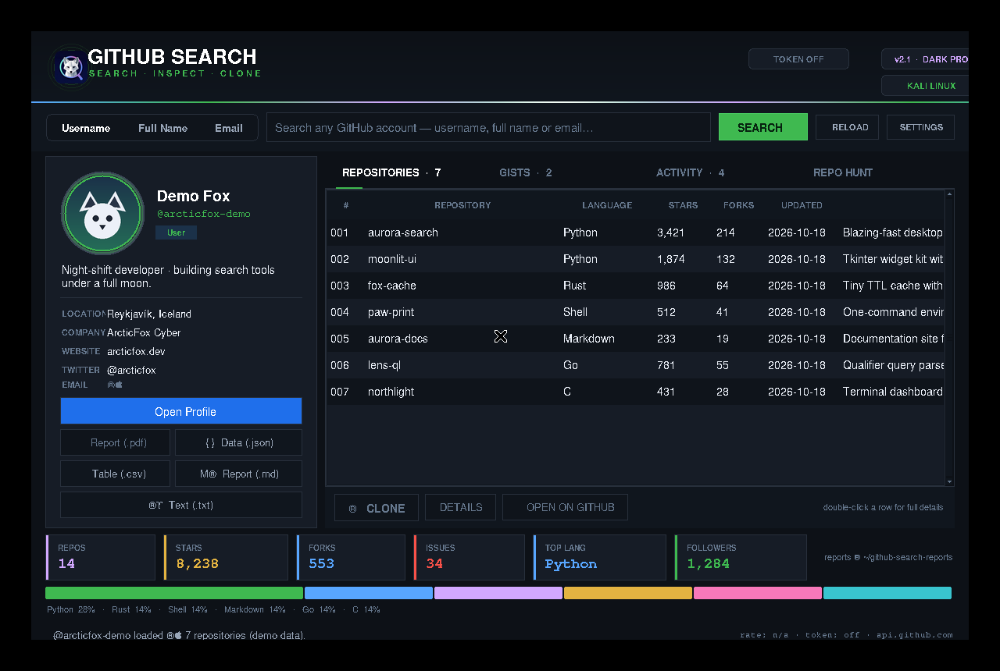
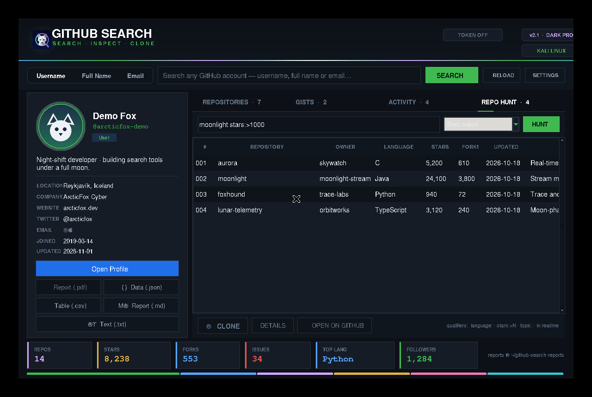
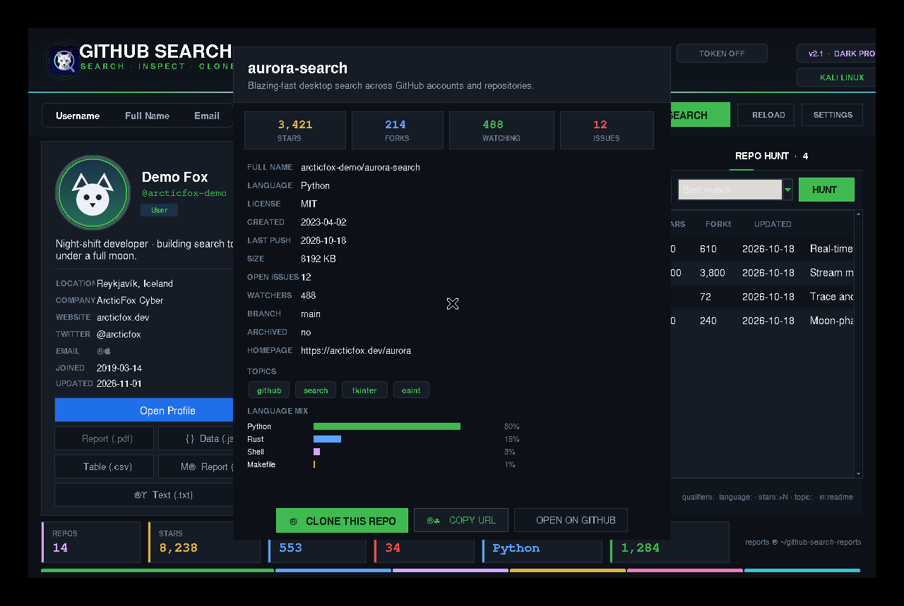
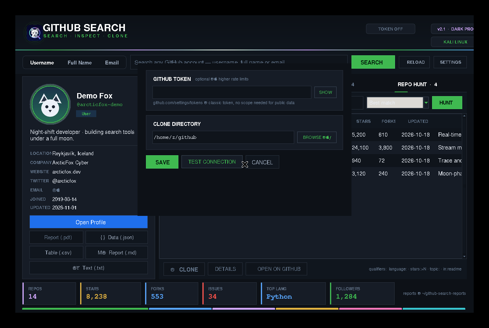

<div align="center">


# GitHub Search v3.0

**GitHub Account & Repository Inspector**

*Born in the snow, built for the hunt.*

[](https://github.com/arcticfox-cyber/GitHub-Search)
[](https://www.kali.org/)
[](https://www.python.org/)
[](LICENSE)

**Search · Inspect · Clone · Export**

[Features](#features) · [Installation](#installation) · [Usage](#usage) · [Screenshots](#screenshots) · [License](#license)

</div>

---

## Overview

GitHub Search is a Python desktop and terminal application for exploring publicly available GitHub account and repository information. Search for users, inspect profiles and repositories, explore gists and public activity, discover repositories across GitHub, clone public projects, and export profile reports.

Version **3.0 — Frostfall** improves PDF report generation with a native Save-As workflow, background processing, and safer handling of incomplete API data. The application also includes the GitHub Dark Pro interface and an in-window arctic-fox startup splash.

## Features

- **Account search:** look up GitHub accounts and inspect public profile information.
- **Profile insights:** review followers, repositories, stars, forks, organizations and other public details.
- **Repository explorer:** inspect languages, topics, update dates, license information and repository statistics.
- **Repo Hunt:** search public GitHub repositories with qualifiers such as `language:python`, `stars:>500` and `topic:security`.
- **Gists and activity:** browse public gists and recent public events.
- **Clone support:** shallow-clone selected public repositories.
- **Five report formats:** export PDF, TXT, JSON, CSV and Markdown reports.
- **Smart API handling:** response caching, retry with backoff and rate-limit visibility.
- **Desktop experience:** GitHub Dark Pro theme, sortable tables, search history and startup splash.
- **Terminal edition:** use the CLI on systems without a graphical desktop.

## Screenshots

<div align="center">

| Main window | Repo Hunt |
|:---:|:---:|
|  |  |

| Repository details | Settings |
|:---:|:---:|
|  |  |

</div>

## Requirements

- Kali Linux or a compatible Debian-based Linux distribution
- Python 3
- Tkinter (`python3-tk`) for the graphical interface
- Git for repository cloning
- Internet access to reach the GitHub API
- A desktop session for GUI mode

Install the required packages:

```bash
sudo apt update
sudo apt install -y python3 python3-tk git xdg-utils curl
```

Pillow is optional. It can improve support for additional image formats:

```bash
python3 -m pip install --user Pillow
```

## Installation

Clone the repository and enter the application directory:

```bash
git clone https://github.com/arcticfox-cyber/GitHub-Search.git
cd GitHub-Search/GitHub-Search-v3
```

Run the installer on Kali Linux:

```bash
sudo bash install.sh
```

For another Debian-based distribution, explicitly override the Kali-only check:

```bash
sudo bash install.sh --force
```

The installer places the application in `/opt/github-search`, creates the `af` and `github-search` commands, installs the desktop launcher, and copies the runtime artwork.

### Quick launch (without installation)

From `GitHub-Search/GitHub-Search-v3`:

```bash
bash run.sh
```

### Remote installer

Review the installer before running it. To download and execute the current main-branch installer:

```bash
curl -fsSL https://raw.githubusercontent.com/arcticfox-cyber/GitHub-Search/main/GitHub-Search-v3/remote-install.sh -o remote-install.sh
less remote-install.sh
sudo bash remote-install.sh
```

## Usage

After installation:

| Command | Description |
|---|---|
| `af` | Launch the desktop application |
| `af octocat` | Launch and search for a GitHub username |
| `af --cli` | Launch the terminal edition |
| `af --cli octocat` | Search for a username in the terminal |
| `af --cli --repos 'tetris language:python stars:>500'` | Search public repositories |
| `af --help` | Display GUI command help |
| `af --version` | Display the application version |

Without installation, run these commands from the application directory:

```bash
bash run.sh
bash run.sh octocat
bash run.sh --cli
python3 arcticfox-cli.py
python3 arcticfox-cli.py octocat
```

### GUI workflow

1. Select a search mode and enter the account search term.
2. Review the profile summary and public account statistics.
3. Explore the Repositories, Gists and Activity tabs.
4. Select a repository to inspect details, open it on GitHub or clone it.
5. Use the export controls to generate a PDF, TXT, JSON, CSV or Markdown report.
6. Open Repo Hunt to discover public repositories using GitHub search qualifiers.
7. Use Settings to configure an optional API token or change the clone directory.

### Terminal workflow

The CLI works without Tkinter or a graphical display:

```bash
python3 arcticfox-cli.py
```

For headless or SSH sessions, use the terminal edition rather than the GUI.

## GitHub API token

A token is optional for public-data lookups. Without authentication, GitHub applies its unauthenticated API rate limit. You can add a personal access token in the application's Settings window to increase the available API rate limit.

The application stores its configuration at:

```text
~/.config/github-search/config.json
```

The configuration file is saved with owner-only permissions where supported. Never publish your token, add it to source code, or include it in screenshots or issue reports.

## Reports and data locations

- **Reports:** `~/github-search-reports/`
- **Configuration:** `~/.config/github-search/config.json`
- **Default clone directory:** `~/github/`
- **Installed application:** `/opt/github-search/`

## Project structure

```text
GitHub-Search/
├── README.md
├── LICENSE
├── logo.png
└── GitHub-Search-v3/
    ├── README.md
    ├── LICENSE
    ├── arcticfox_gui.py
    ├── arcticfox-cli.py
    ├── arcticfox_core.py
    ├── install.sh
    ├── remote-install.sh
    ├── run.sh
    ├── doctor.sh
    ├── assets/
    └── docs/
```

## Troubleshooting

**GUI does not start**

```bash
sudo apt update
sudo apt install -y python3 python3-tk
```

Then, from the application directory, run:

```bash
bash doctor.sh
python3 arcticfox_gui.py
```

**Startup splash is missing**

Confirm that `GitHub-Search-v3/assets/moonlit-fox-splash.png` exists in the repository. If the application is installed, reinstall it from the application directory:

```bash
sudo bash install.sh
```

**GitHub API rate limit reached**

Wait for the limit to reset or configure a personal access token in Settings. Do not share the token.

**No desktop display / SSH session**

Use the terminal edition:

```bash
python3 arcticfox-cli.py
```

**Remove the installed application**

From the application directory:

```bash
sudo bash install.sh --uninstall
```

The uninstaller removes the installed application and launchers. It intentionally keeps the user's configuration and generated reports.

## Security and responsible use

GitHub Search accesses information through the official GitHub REST API and does not bypass GitHub access controls. It is intended for responsible inspection of publicly available information. Respect GitHub's terms, API limits, privacy expectations and the rights of repository owners. Keep API tokens private.

## Version

**Current release: 3.0 — Frostfall**

See the [application README](GitHub-Search-v3/README.md) for the detailed feature history and implementation notes.

## License

GitHub Search is proprietary software. All rights are reserved by the copyright holder. This repository is publicly viewable, but public visibility does not grant permission to redistribute, modify, sublicense or commercially exploit the software.

See the [LICENSE](LICENSE) file for the complete terms. This project is **not** released under MIT, Apache-2.0, GPL, BSD or another open-source license.

## Support

Report bugs through [GitHub Issues](https://github.com/arcticfox-cyber/GitHub-Search/issues). Include your Linux distribution, Python version, exact command and relevant error output. Remove tokens and other secrets before posting logs.

<div align="center">

**GITHUB SEARCH · ARCTIC FOX**

*Explore. Discover. Inspect.*

Developed by [@arcticfox-cyber](https://github.com/arcticfox-cyber)

</div>
